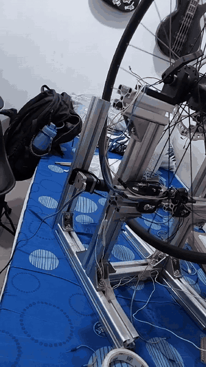
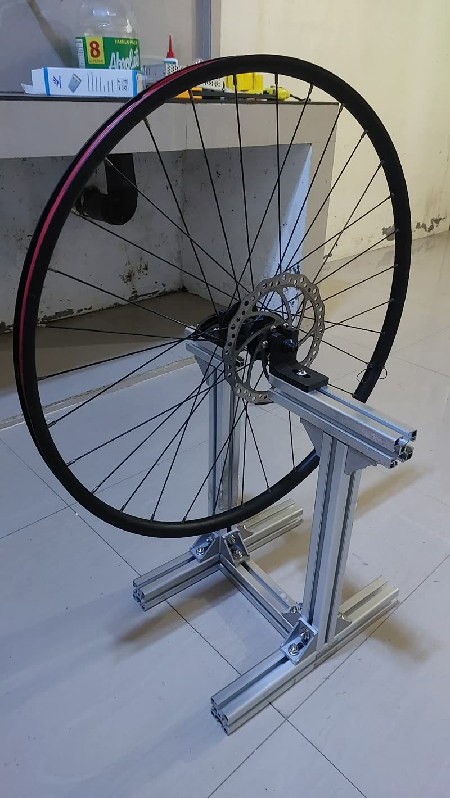

# truing-bench

Firmware and test rig for a bicycle-wheel truing machine. A roller turns the wheel, a laser finds each
spoke, a solenoid plucks it and a microphone listens, all on one ESP32-S3.



*The roller turning the wheel (8 s of a 30 s clip). Status as of 2026-10-13: a full-pipeline video does
not exist yet. The rig is disassembled and one will be recorded when it is rebuilt.*

## What it is for

A bicycle wheel carries the bike and the rider through its spokes, the thin wires that form the web. Each
spoke can be tightened or loosened. If some spokes pull harder than others the rim is dragged out of
round, and a rim that is out of true rides badly and is not safe. People fix this by hand, which is called
truing a wheel. This machine is meant to automate it.

The plan has four parts:

1. **Measure each spoke's tension** by plucking it and listening to the pitch.
2. **Measure how far the rim is from true** (runout).
3. **Compute** how much each nipple needs to turn.
4. **Turn the nipples** and check the result.

Only parts of 1 are built and tested so far; see Status.

The part I think matters most is **indexing**: the machine knowing where each spoke is. Used wheels are
not uniform, and counting motor steps as if they were gives drift. Finding each spoke with a laser removes
that guess. A machine that knows where the spoke is, both for plucking and for adjusting, is what
"autonomous" has to mean here. Plucking has that now. Adjusting does not.

## What it does today

1. The operator puts spoke 0 just before the laser beam and confirms.
2. A stepper-driven roller turns the wheel. When a spoke breaks the laser beam the roller decelerates and
   stops with that spoke at the solenoid. The firmware names each stopped spoke from the wheel's measured
   spacing before it fires, and backs up and retries if it stopped on the wrong one.
3. The solenoid strikes the spoke, the station's INMP441 microphone records it, and the firmware analyses
   the recording (gate, Hann window, zero-padding, FFT, peak pick, parabolic interpolation) to a frequency.
4. Steps 2 and 3 repeat for all 32 spokes and the page the board serves shows the readings.

Everything after that (runout, solving for adjustments, turning nipples) exists as software that is tested
on a PC against synthetic wheels, but has not been run on a real wheel. The operator does those physical
steps by hand.

## Results

| What was checked | Result |
|---|---|
| Host test suite (326 cases, no hardware) | all pass, run 2026-10-13 |
| Laser-guided roller, full revolution of the 32-spoke wheel | 32 of 32 spokes stopped on and struck, counted by the operator's eye; repeated on the firmware image itself on 2026-10-03 |
| C analysis against the Python research pipeline, same samples | worst difference 0.0000 Hz in f1 over 3 recorded plucks |
| Time for one analysis on the ESP32-S3 | 16.2 s at first, 3.7 s after profiling and platform settings |
| Frequency ruler, independent re-implementation, same samples | identical peaks on 20 of 20 real events and 17 synthetic cases |
| Hand pluck, one spoke, unchanged DSP | 5 of 15 pass the quality gate; 4 of those agree within 0.2 Hz at 406.2 Hz |
| Solenoid strikes, same DSP | 4 of 168 pass in the pre-registered strike blocks; 1 of 54 in a later pulse-width sweep |

Limits, stated plainly:

- **The solenoid does not currently produce a usable spoke frequency.** The plunger rings the rig as much
  as the spoke, and the DSP's quality gates reject nearly every strike. A hand pluck reads on the same
  chain. Why the strike differs is a hypothesis, not a finding.
- **No tension from this machine has been compared with a tensiometer.** The frequency-to-tension
  relation in the firmware is a model, not a calibrated one, and the active configuration excludes
  tension from the solve on purpose.
- **"32 of 32" means the strike hit the spoke**, as judged by the operator. It does not mean the strike
  produced a usable frequency. The roller's stop distances were tuned on one wheel, and how often a spoke
  had to be handed back to the operator on the firmware image was not recorded.
- **The demonstration image shows a number for captures the DSP would reject.** It reports a forced
  frequency candidate and labels nothing as valid. It demonstrates the pipeline running, not that the
  acoustic method works. Its adjustment plan uses a reference slope (473 N per turn) that was not
  measured on this wheel. See [docs/DEMO_BUILD.md](autonomous_truing_machine/docs/DEMO_BUILD.md).
- The ruler audit shows the FFT peak-picking is numerically right. It does not show the peak chosen is the
  spoke's fundamental. See [docs/ACOUSTIC_RESEARCH.md](autonomous_truing_machine/docs/ACOUSTIC_RESEARCH.md).
- One wheel throughout: a 32-spoke front disc wheel.

## What's inside

| Part | Details |
|---|---|
| Board | ESP32-S3-DevKitC-1 (N16R8), ESP-IDF 5.4 through PlatformIO |
| Firmware | about 53,000 lines of C and headers (tests and fixtures included) in subsystems with enforced dependency rules: core data, solver, DSP, hardware interfaces, orchestrator state machine, wire protocol, one board-profile header per board. Real, recorded and synthetic implementations sit behind the same interfaces |
| Specification | [docs/SPEC.md](autonomous_truing_machine/docs/SPEC.md), about 32,000 words, the contract the code is tested against |
| Microphones | two INMP441 I2S MEMS microphones, one per strike station |
| Pluck | two solenoids (JF-0530B, 12 V) driven by logic-level MOSFETs with flyback diodes |
| Wheel drive | NEMA 17 stepper on a TMC2209 driver, polyurethane roller on the wheel |
| Indexing | 650 nm laser and break-beam receiver across the strike point |
| Model preparation | Python in [model_prep/](model_prep/): builds the influence-matrix artifact the solver uses, so the ESP32 never does an SVD |
| Tools | PC-side bench tooling in [tools/](autonomous_truing_machine/tools/): pre-registered solenoid campaign runner, capture replay, workbench, flashing |
| Frame | aluminium extrusion with brackets for the wheel seat, solenoids, microphones and laser |



The mounts were modelled in CAD before they were printed:
[frame dimensions](autonomous_truing_machine/docs/media/cad-frame-dimensions.jpg),
[solenoid stations](autonomous_truing_machine/docs/media/cad-solenoid-stations.jpg),
[laser beam at a solenoid](autonomous_truing_machine/docs/media/cad-laser-beam-at-solenoid.jpg).

Evidence and design notes, newest work first: [roller bench](autonomous_truing_machine/docs/ROLLER_BENCH.md),
[laser bench](autonomous_truing_machine/docs/LASER_BENCH.md),
[alignment campaign](autonomous_truing_machine/docs/ALIGN_CAMPAIGN.md),
[solenoid campaign record](autonomous_truing_machine/docs/SOLENOID_CAMPAIGN.md),
[bring-up log](autonomous_truing_machine/docs/BRINGUP_LOG.md),
[implementation notes](autonomous_truing_machine/docs/IMPLEMENTATION_NOTES.md),
[developer notes](autonomous_truing_machine/docs/DEV_NOTES.md).

## What went wrong along the way

- **The solenoid rings the rig.** The research constants came from recordings made with a magnetic
  pickup. On this rig a plunger strike lights up dozens of structural lines, and the spoke's own line, if
  it is there, is neither the lowest nor the strongest. I first suspected mains hum, tested that against
  recordings, and dropped it when the operator's ear and the data disagreed with the theory. Hand plucks
  read fine on the same chain, which points at the excitation, not the DSP. It is still open.
- **A wiring mistake killed the first board.** While adding the second microphone I damaged the Arduino
  Nano ESP32 that carried the acoustic rig (2026-09-27). The whole acoustic front end moved to a spare
  DevKitC-1. The solenoids on the new board stay disabled in firmware until each one passes its own
  electrical check, because wiring them without it would repeat the unverified assumption behind the loss.
- **I guessed wrong about what was slow.** One analysis took 16.2 s on the chip. I suspected the peak
  prominence scan; the profile said it was under 1% of the time. The real cost was double-precision
  trigonometry in software, because the S3 has no double-precision FPU. The default clock, compiler and
  cache settings cost another 1.6x. Fixing those took it to 3.7 s.
- **The laser receiver's listing was backwards.** The seller says the output goes low with no laser; on
  this unit it goes low while the laser hits it. I tested it first, before writing the edge
  detection around it.

## Status

Working:

- the host-tested firmware: solver, orchestrator state machine, protocol, and the DSP port
- on-target bring-up and self-checks, recorded in the bring-up log
- the roller turning the wheel and stopping a chosen spoke at the solenoid, guided by the laser
- reading a hand-plucked spoke through the microphone and DSP, on one spoke

Not working:

- getting a usable spoke frequency from a solenoid strike

Not built, or built but never run on a real wheel:

- automatic runout measurement (the operator enters it by hand)
- nipple turning (the operator does it; the firmware only displays the turns)
- the solver and the adjustment loop on a real wheel (synthetic wheels only)
- tension validated against a reference meter

## Build and run

```
pio run -e s3_devkit_demo                 # the demonstration image
pio test -e native                        # host tests, no board needed
```

ESP-IDF refuses build paths that contain a space; see
[docs/DEV_NOTES.md](autonomous_truing_machine/docs/DEV_NOTES.md) for the junction workaround and which of
the images to build. Run `pio` from `autonomous_truing_machine/`. Model preparation:
`cd model_prep && python -m pytest -q`.

Each board starts its own Wi-Fi access point and serves the page at `http://192.168.4.1/`. The network name
and passphrase are derived from the board's MAC address by a public formula, so anyone in range can work
out the passphrase. The demonstration image instead uses a fixed passphrase, `truing-demo`, which is in the
source.

## About this project

This was a team project. I wrote the firmware and the test tooling, designed and integrated the
electronics (solenoid drive, microphones, stepper driver, laser), and ran the bench work. A teammate did
the 3D design and planning of the structure: the aluminium-extrusion frame, the wheel seat, and the
solenoid and microphone brackets.

The code is AI-assisted. I direct the work, decide the design, and integrate and test the hardware.

No licence has been chosen yet, so all rights are reserved for now.
